<div align="center">


# The Talking World

**Learn new languages just by scanning the world around you with your camera.**

Point your phone at any object, and the app recognizes it with Gemini AI, translates it from Greek into the language you're learning, and pronounces it out loud.


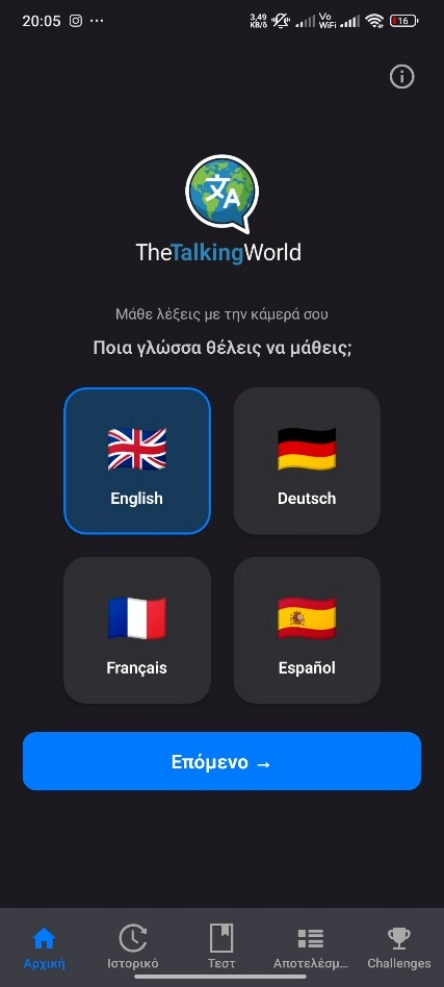&nbsp;
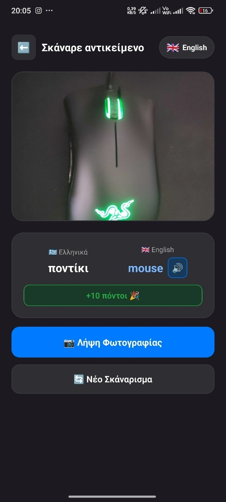&nbsp;
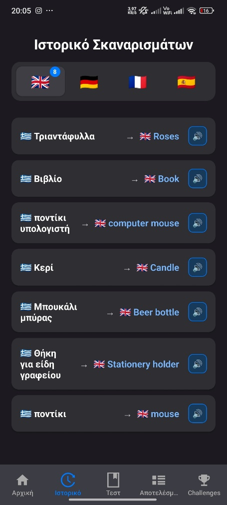&nbsp;
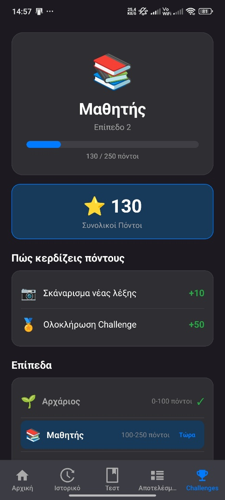

</div>

---

## Table of contents

- [The problem](#the-problem)
- [How it works](#how-it-works)
- [Supported languages](#supported-languages)
- [Key features](#key-features)
- [Screens](#screens)
- [Gamification](#gamification)
- [Tech stack](#tech-stack)
- [Project structure](#project-structure)
- [Getting started](#getting-started)
- [Team](#team)

---

## The problem

Traditional language-learning apps keep you stuck in repetitive drills: flashcards, fill-in-the-blanks, disconnected exercises. They teach language in isolation, not in context. Real learning happens in the real world.

| The old way | The new way |
| --- | --- |
| Memorize lists. Repeat drills. Forget by morning. | Point your camera. Test yourself. Track your progress. |

## How it works

Four simple steps, powered by Gemini AI for object recognition and translation:

1. **Pick a language**: choose the language you want to learn.
2. **Raise the camera**: take a photo of any object around you.
3. **The AI recognizes it**: the image is sent to the backend, which identifies the object and returns its Greek name and its translation.
4. **Hear the pronunciation**: the translated word is read aloud instantly with text-to-speech.

No books. No boring drills. Just point, scan, and learn on the spot, wherever you are.

```
📷 Photo ──► base64 ──► Flask API (Hugging Face + Gemini) ──► { objectGr, objectTr }
                                                                    │
                       ┌────────────────────┬───────────────────────┼─────────────────┐
                       ▼                    ▼                       ▼                 ▼
                 SQLite (history)     +10 points          Challenge check      🔊 expo-speech
```

## Supported languages

Translation goes **from Greek** into one of four of the world's most widely spoken languages. Each one has its own word history, challenge, and quiz section.

| Language | TTS voice |
| --- | --- |
| 🇬🇧 English | `en-US` |
| 🇩🇪 German (Deutsch) | `de-DE` |
| 🇫🇷 French (Français) | `fr-FR` |
| 🇪🇸 Spanish (Español) | `es-ES` |

## Key features

- 🤖 **AI object scanner**: scan any real-world object and instantly get its name in the selected language.
- 🔊 **Text-to-speech**: natural-sounding pronunciation right after a scan, and on demand from the word history.
- 📖 **Word history**: browse every word you've scanned, organized by language.
- 📝 **Knowledge tests**: multiple-choice and written quizzes to reinforce what you've learned.
- 🏆 **Challenges & points**: complete challenges, earn points, and level up.
- 📊 **Test history**: track your quiz scores and watch your progress grow over time.

## Screens

The app has seven screens (based on the project storyboard). Navigation is done mainly through a bottom tab bar (**Αρχική · Ιστορικό · Τεστ · Αποτελέσματα · Challenges**), so the user can move between screens in any order.

### TTW-S01 · Splash screen

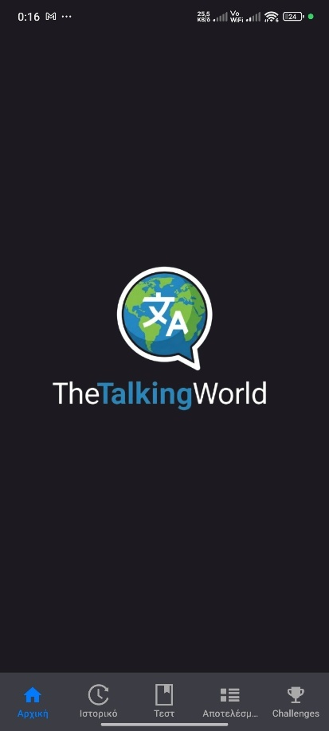

The first screen shown at launch: the centered app logo on a dark background (`#1D1D21`).

- Shown for **2.5 seconds** (`setTimeout 2500ms`), then moves automatically to Home.
- Appears **only on the first launch**, controlled by a module-level `hasLoadedOnce` flag.

<br clear="right"/>

### TTW-S02 · Home (language selection)


The main screen for choosing a target language.

- Logo plus the subtitle *«Μάθε λέξεις με την κάμερά σου»* ("Learn words with your camera").
- Four language cards in a 2×2 grid. The selected card gets a blue border.
- The **«Επόμενο →»** (Next) button stays disabled until a language is selected.
- On mount, `initDB()` creates the SQLite tables, and the last-used language is restored from `AsyncStorage`.
- Pressing Next saves the choice and calls `router.push('/scan', { targetLang })`.

<br clear="right"/>

### TTW-S03 · Scan

<p>
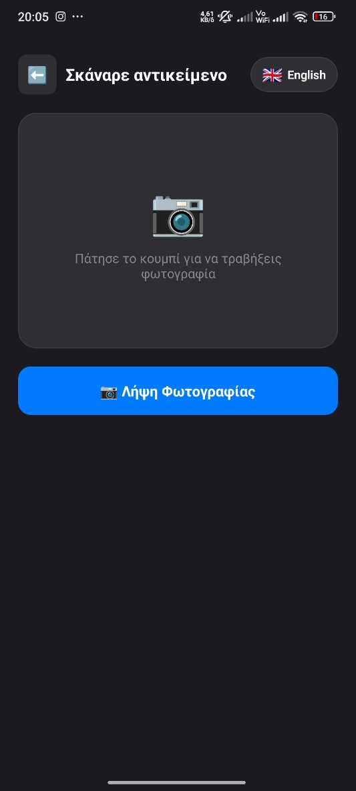&nbsp;

</p>

The core learning screen. The user photographs an object and gets its translation.

- **States:** *Idle* (empty camera box), *Loading* (overlay with an activity indicator), and *Result*.
- The result shows two columns, 🇬🇷 Greek word → 🌍 translation, with a 🔊 replay button and a **«+10 πόντοι 🎉»** badge.
- `ImagePicker.launchCameraAsync({ base64: true, quality: 0.5 })` sends a `POST` to the Flask API with `{ image, target_lang }`.
- The response `{ objectGr, objectTr }` goes through `saveObject()` (SQLite), `addPoints(+10)`, `checkAndCompleteChallenge()`, and `Speech.speak()`.

### TTW-S04 · Word history


All scanned words, organized by language.

- Four language tabs, each with a badge showing its word count.
- Each card shows the Greek word → the translation, with a 🔊 button that speaks it in the active tab's language.
- The tab of the last-used language is selected automatically (`useFocusEffect` + `AsyncStorage`).

<br clear="right"/>

### TTW-S05 · Knowledge tests

<p>
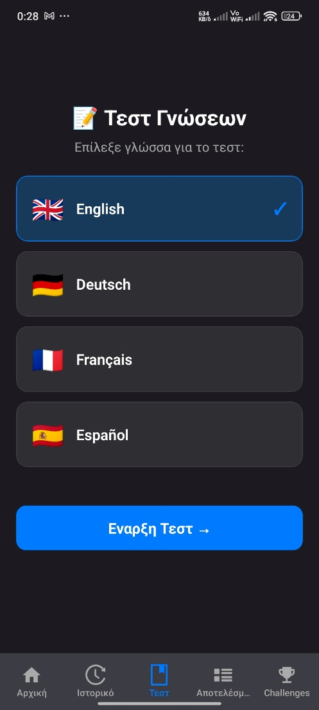&nbsp;
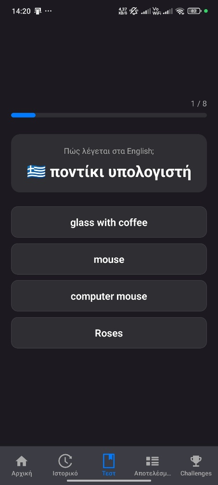&nbsp;
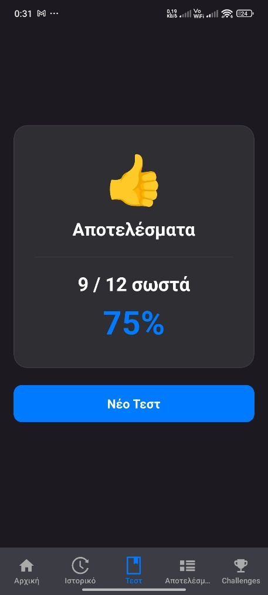
</p>

A three-phase flow: **language selection → quiz → results**.

- A progress bar shows the current question out of the total.
- Each question asks *«Πώς λέγεται στα X;»* ("How do you say it in X?") and alternates between written answers and 4-option multiple choice (`i % 2 === 0`).
- Feedback is instant: green for correct, red for wrong. Answers are compared case-insensitively.
- The results screen shows the score and percentage with an emoji (🎉 / 😊 / 💪). Each test is saved to SQLite.

### TTW-S06 · Test history

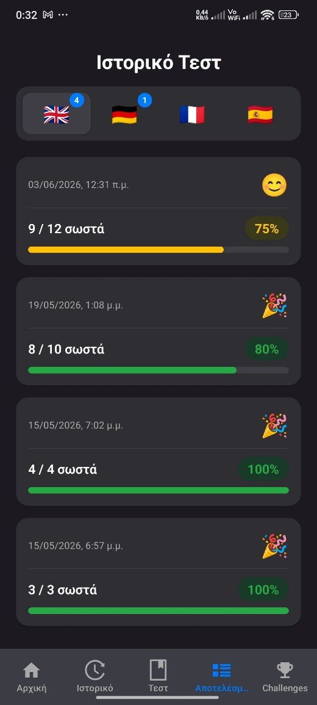

The history of every test you've taken, grouped by language.

- Each card shows the flag, date, emoji, score (*X/Y σωστά*, "X/Y correct"), a colored percentage badge, and a progress bar.
- Color scale: **≥ 80 %** green 🎉 · **50–79 %** yellow 😊 · **< 50 %** red 💪

<br clear="right"/>

### TTW-S07 · Challenges & levels

<p>
&nbsp;
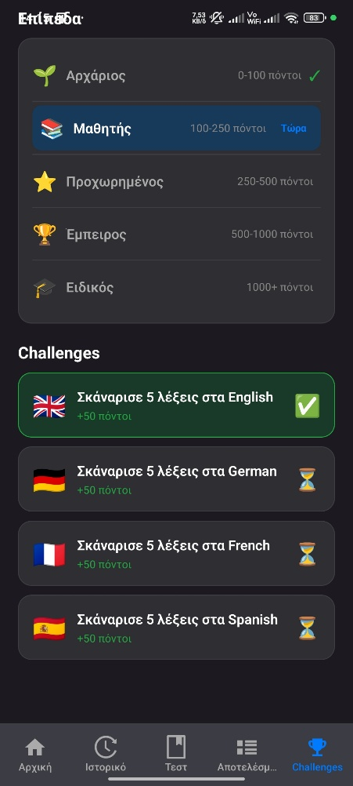
</p>

The gamification hub: a current level card with a progress bar, total points, how to earn points, all levels with the current one highlighted, and one challenge per language (✅ completed / ⏳ pending).

## Gamification

Every scan and every challenge pushes you forward. Collect points and climb the levels.

| Action | Points |
| --- | --- |
| Each new word scanned | **+10** |
| Completing a language challenge (scan 5 words in that language) | **+50** |

| Level | Title | Points |
| --- | --- | --- |
| 1 | 🌱 Αρχάριος (Beginner) | 0 – 99 |
| 2 | 📚 Μαθητής (Student) | 100 – 249 |
| 3 | ⭐ Προχωρημένος (Advanced) | 250 – 499 |
| 4 | 🏆 Έμπειρος (Experienced) | 500 – 999 |
| 5 | 🎓 Ειδικός (Expert) | 1000+ |

## Tech stack

| Layer | Technology |
| --- | --- |
| **Frontend** | React Native 0.81 + Expo SDK 54 with **Expo Router** (file-based routing) for iOS & Android |
| **AI backend** | Python **Flask** + **Google Gemini AI API**, hosted on **Hugging Face Spaces** |
| **Local storage** | **SQLite** via `expo-sqlite` (words, tests, points, challenges) + `AsyncStorage` (last-used language) |
| **Audio** | `expo-speech` for real-time text-to-speech |
| **Camera** | `expo-image-picker` |

### Database tables

| Table | Purpose |
| --- | --- |
| `object` | Scanned words: the Greek name plus English, German, French, and Spanish translations |
| `test` | Quiz results per language |
| `points` | Accumulated points |
| `challenges` | Challenge status per language |

## Project structure

```
TheTalkingWorld/
├── app/
│   ├── (tabs)/
│   │   ├── _layout.tsx      # Bottom tab navigator
│   │   ├── index.tsx        # TTW-S01/S02 · Splash + Home (language selection)
│   │   ├── history.tsx      # TTW-S04 · Word history
│   │   ├── tests.tsx        # TTW-S05 · Knowledge tests
│   │   ├── testhistory.tsx  # TTW-S06 · Test history
│   │   └── challenges.tsx   # TTW-S07 · Challenges & levels
│   ├── scan.tsx             # TTW-S03 · Camera scan + translation
│   └── modal.tsx
├── services/
│   └── database.ts          # SQLite schema & queries
├── components/              # Themed UI components
├── constants/theme.ts
├── assets/images/           # App icon & logo
├── screenshots/             # README screenshots
├── app.json
└── eas.json                 # EAS Build config
```

## Getting started

### Prerequisites

- Node.js (LTS) and npm
- The [Expo Go](https://expo.dev/go) app on your phone, or an Android emulator / iOS simulator

### Installation

```bash
git clone https://github.com/dimitrisv2005/kazanidis.git TheTalkingWorld
cd TheTalkingWorld
npm install
npx expo start
```

Then scan the QR code with Expo Go (Android) or the Camera app (iOS), or press `a` / `i` to open an emulator.

### Backend

The app calls an already-deployed translation API:

```
POST https://dimisv1-object-translation-api.hf.space/scan
Content-Type: application/json

{ "image": "<base64 jpeg>", "target_lang": "English" }

→ { "objectGr": "ποντίκι", "objectTr": "mouse" }
```

`target_lang` is one of `English`, `German`, `French`, or `Spanish`. To use your own backend, change `FLASK_URL` in `app/scan.tsx`.

### Building an APK

```bash
npm install -g eas-cli
eas build -p android
```

## Team

Project for the 6th-semester course **«Εκπαιδευτική Καινοτομία και Ανάπτυξη Εφαρμογών»** (Educational Innovation and Application Development), Team **A4**, Democritus University of Thrace.

| Name | Student ID |
| --- | --- |
| Βασιλτσής Δημήτριος | 230018 |
| Δαράκης Ιωάννης | 230047 |
| Γκιλιόπουλος Νικόλαος | 230029 |

---

<div align="center">

*Turn the world around you into your classroom and learn effortlessly, anytime, anywhere, with just your phone's camera.*

</div>
